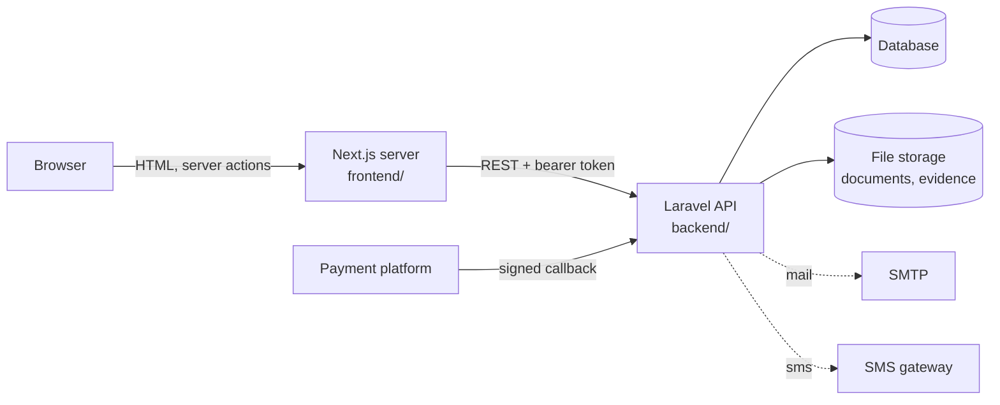
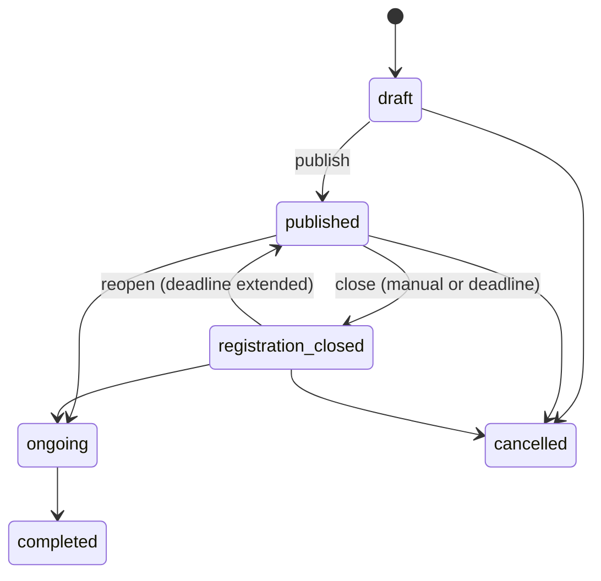
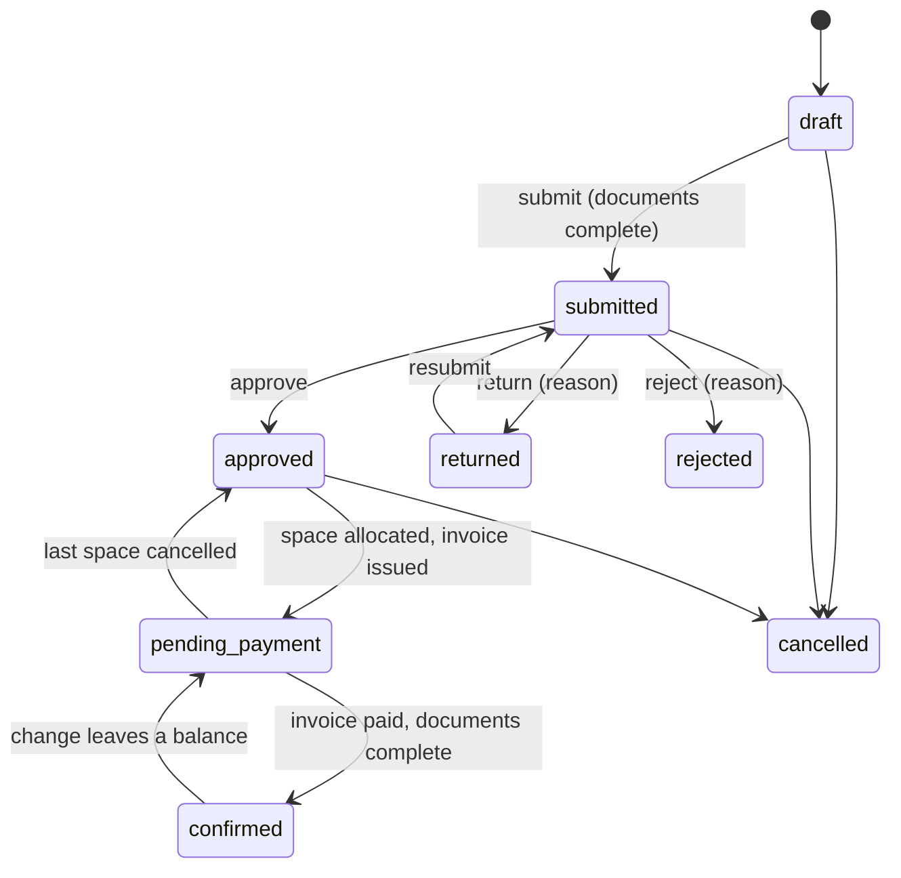
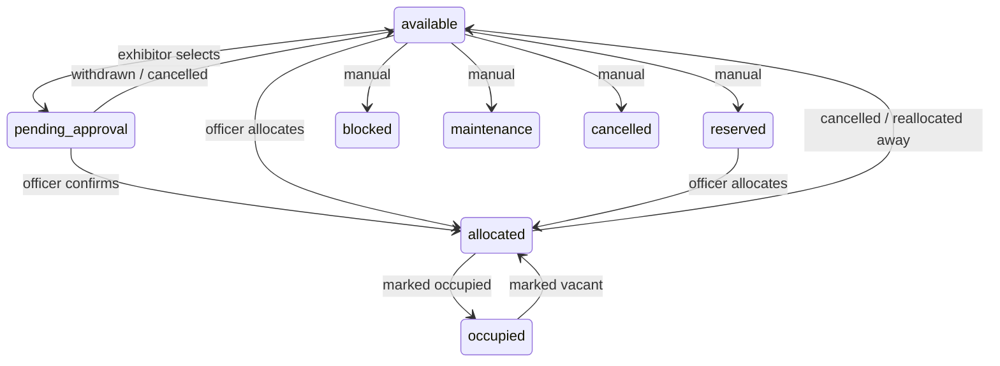

# 03 — Software design document

## 1. Architecture



Two deployable parts:

- **Laravel API** owns the data and every rule. Nothing about permissions or business rules lives anywhere else.
- **Next.js web client** renders pages on the server and forwards the user's actions to the API. It holds no data of its own.

**Why the browser never calls the API directly.** The session token is stored in an httpOnly cookie on the Next.js origin. Server components and server actions read it and call the API. Browser JavaScript cannot read the token, the API needs no CORS configuration, and the Content Security Policy can stay at `connect-src 'self'`. File downloads go through `/api/files/…`, an allow-listed streaming proxy.

## 2. Backend structure

| Path | Responsibility |
|---|---|
| `config/gememis.php` | Roles, permissions, status vocabularies. The only place a permission is defined |
| `app/Models` | Eloquent models and relations |
| `app/Services/AllocationService.php` | Allocate, confirm, auto-allocate, reallocate, transfer, cancel |
| `app/Services/BillingService.php` | Invoice lines, totals and status, payment submission, verification, participation confirmation |
| `app/Services/Audit.php` | One call writes an audit entry |
| `app/Services/Notifier.php` | In-system notification plus email and SMS dispatch |
| `app/Services/Ref.php` | Reference numbers derived from row ids |
| `app/Http/Controllers/Api` | Validation, permission check, call a service, return JSON |
| `app/Http/Middleware/EnsureAccountUsable.php` | Blocks deactivated or locked accounts; forces a temporary password to be changed |
| `app/Console/Commands/Housekeeping.php` | Daily calendar rules: close registration, flag overdue invoices, send reminders |
| `resources/views/pdf` | PDF templates |

## 3. Frontend structure

| Path | Responsibility |
|---|---|
| `lib/api.ts` | The single HTTP client for the API (server only) |
| `lib/auth/session.ts` | Current session, permission checks for pages |
| `lib/exhibition.ts` | Which exhibition the user is working in (cookie) |
| `server/actions.ts` | Login, register, logout, and one generic `mutate`/`call` write action |
| `proxy.ts` | Redirects signed-out visitors to the sign-in page |
| `app/(auth)` | Sign in, register, change password |
| `app/(app)` | All signed-in pages, wrapped in the shell |
| `components/core/morphing-dialog.tsx` | The shared-layout morph between a trigger and a dialog |
| `components/ui/morph-form.tsx` | `MorphForm` (button → form dialog) and `MorphCard` (card → detail dialog) |
| `components/ui/action-form.tsx` | A form wired to `mutate`, with field errors, alert and live submit button |
| `components/spaces/space-map.tsx` | The floor plan |
| `styles/globals.css` | Design tokens, accents, HeroUI and daisyUI setup |

### The generic write action

Every form and button uses `mutate(spec, …)` or `call(spec)`, where `spec` is `{method, path, …}` bound on the client. This is deliberate: the action carries no authority of its own. The request runs with the caller's token and the API decides whether that role may do it. A user who tampers with the spec can only do what they could already do by calling the API with their own token. The benefit is one write path to secure and test instead of one per form.

### Visual design

The interface reuses the TANTRADE Project Tracking Portal's design system unchanged: Manrope type, the surface/canvas tokens, the hover-expanding icon rail, the pill top bar, animated highlight backgrounds, live buttons that show pending/success/error, and morphing dialogs. The default accent is gold. Users can change the accent and reduce motion in Settings; both are stored in cookies and applied in the first server render.

## 4. Key design decisions

### 4.1 Double allocation is impossible, not merely checked (BR-001, FR-010)

`allocations.active_space_id` equals `space_id` while an allocation is live (`pending` or `allocated`) and is set to `NULL` when it ends. The column has a **unique index**. Two live allocations of one space therefore cannot both exist, even if two officers submit at the same instant and both pass the application-level availability check. The second insert fails; the service turns the database error into "Space X has just been taken by another exhibitor."

History is preserved: ended allocations keep their `space_id` and simply drop out of the unique index.

### 4.2 One open invoice per application (FR-031)

When a space is allocated, a line is added to the application's open invoice, or a new invoice is created. Totals and status are recomputed from the lines and the verified payments every time, never adjusted incrementally, so they cannot drift.

- Reallocation re-points the existing line at the new space on the same invoice.
- Cancellation and transfer remove the line. An invoice left with no lines and no payments becomes `cancelled`.
- If a change leaves an invoice paid above its new total, it stays `paid` and the difference is a credit to settle outside the system. There is no refund workflow in 1.0.0.

### 4.3 Self-selection is a request, not an allocation (FR-023)

An exhibitor's selection creates a `pending` allocation and sets the space to `pending_approval`. That holds the space (the unique index applies) but raises no invoice. The invoice is generated when an officer confirms.

### 4.4 Audit entries are written in the same transaction (BR-007)

Allocation changes, billing and their audit entries commit or roll back together. `AuditLog` refuses `update` and `delete` at the model level; production adds database triggers (`09-operations.md`).

### 4.5 Registration window is computed, not stored (BR-010)

`registration_open` is derived from the status and the two dates on every read, so an application is refused the day after the deadline even if the daily job has not run yet. The job only moves the status label.

## 5. State machines

### Exhibition


### Application


### Space


### Invoice and payment
Invoice status is a function of its lines, verified payments and due date: `cancelled` (no lines, nothing paid) → `paid` (paid ≥ total) → `partially_paid` (paid > 0) → `overdue` (past due) → `unpaid`. A payment is `pending` until Finance or the gateway marks it `verified` (issuing a receipt number) or `rejected`.

## 6. Sequence: allocation to confirmation

```mermaid
sequenceDiagram
  actor O as Space officer
  actor X as Exhibitor
  actor F as Finance officer
  participant API
  participant DB
  O->>API: POST /allocations {application, space}
  API->>DB: begin; lock space; insert allocation (unique index)
  API->>DB: space=allocated; invoice line; totals; audit; commit
  API-->>X: notify "Space allocated", "Invoice issued"
  X->>API: POST /invoices/{id}/payments (+ evidence)
  API-->>F: notify "Payment awaiting verification"
  F->>API: POST /payments/{id}/verify
  API->>DB: payment=verified; receipt no.; invoice=paid; application=confirmed; audit
  API-->>X: notify "Payment verified", "Participation confirmed"
  X->>API: GET /applications/{id}/allocation-letter
```

## 7. Security design

| Threat | Control |
|---|---|
| Stolen token via XSS | Token in httpOnly cookie; CSP; no token in browser storage |
| Acting outside one's role | Permission check in every controller; UI hiding is a courtesy only |
| Exhibitor reading another's records | `ownOrStaff()` on every record read; list queries scoped to the exhibitor |
| Password guessing | Lock after 5 failures; rate limit; audit of failed sign-ins |
| Forged payment callback | HMAC-SHA256 of the raw body with a shared secret; idempotent on transaction id |
| Tampering with history | Append-only audit log |
| Malicious upload | Type and size validation; files stored outside the web root; served only through authorised endpoints |
| Open redirect after sign-in | `next` accepted only if it is a same-site path |
