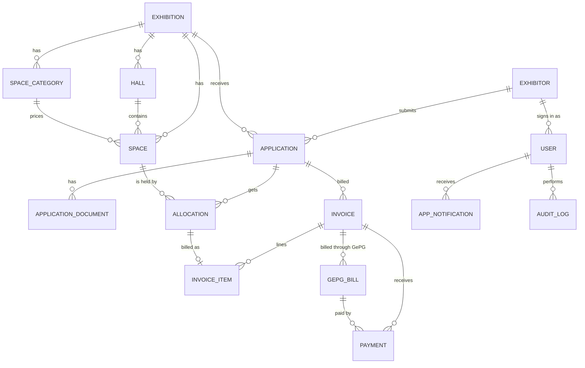

# 04 — Data dictionary

Source of truth: `backend/database/migrations/2026_11_17_000000_create_gememis_tables.php`. All tables have `id` (bigint, PK) and, unless noted, `created_at` / `updated_at`.

## exhibitors
| Column | Type | Notes |
|---|---|---|
| organization_name | string | Indexed |
| registration_number | string, null | Business registration |
| tin | string, null | Tax identification number |
| contact_person | string | |
| phone | string(30) | |
| email | string | |
| physical_address | string, null | |
| country | string(80) | One of the names in `backend/config/countries.php` (validated); default `Tanzania` |
| business_sector | string, null | |
| business_activity | text, null | |
| exhibitor_type | string(30) | `local`, `international`, `government`, `sme` |
| status | string(20) | `active`, `suspended` |

## users
| Column | Type | Notes |
|---|---|---|
| name, email, password | | Email unique; password bcrypt |
| phone | string(30), null | Used for SMS |
| role | string(40) | One of the nine roles; indexed |
| is_active | boolean | Deactivated accounts cannot sign in |
| must_change_password | boolean | Set with a temporary password |
| failed_logins | tinyint | Reset on success |
| locked_at | timestamp, null | Set at 5 failures |
| last_login_at | timestamp, null | |
| exhibitor_id | FK exhibitors, null | Set for exhibitor accounts |

## exhibitions
| Column | Type | Notes |
|---|---|---|
| code | string(30) | Unique; appears in reference numbers |
| name, theme, objectives, venue | | |
| start_date, end_date | date | |
| registration_opens_on, registration_closes_on | date | Closing ≤ start date |
| payment_deadline | date | Default invoice due date |
| categories | json | Exhibition (sector) categories |
| required_documents | json | Mandatory document types (BR-003) |
| terms | text, null | |
| contact_email, contact_phone | | |
| currency | string(3) | Default `TZS` |
| vat_rate | decimal(5,2) | Default 18 |
| allow_self_selection | boolean | FR-023 switch |
| status | string(30) | `draft`, `published`, `registration_closed`, `ongoing`, `completed`, `cancelled` |
| published_at | timestamp, null | |
| created_by | FK users, null | |

## halls
| Column | Type | Notes |
|---|---|---|
| exhibition_id | FK | |
| code | string(20) | Unique within the exhibition |
| name | string | |
| kind | string(20) | `indoor`, `outdoor`, `pavilion` |
| description | string, null | |
| grid_cols | smallint | Spaces per row on the map |
| sort | smallint | Display order |

## space_categories
| Column | Type | Notes |
|---|---|---|
| exhibition_id | FK | |
| code | string(20) | Unique within the exhibition |
| name, description | | |
| price_per_sqm | decimal(14,2) | FR-008 |
| color | string(9) | Hex colour for the map |
| gfs_code | string(20), null | GePG revenue (GFS) code this category's fees are booked under |

## spaces
| Column | Type | Notes |
|---|---|---|
| exhibition_id, hall_id, space_category_id | FK | |
| number | string(20) | Unique within the exhibition |
| width_m, length_m | decimal(6,2) | |
| area_sqm | decimal(8,2) | width × length |
| price | decimal(14,2) | Excluding VAT |
| status | string(30) | `available`, `reserved`, `pending_approval`, `allocated`, `occupied`, `blocked`, `cancelled`, `maintenance` |
| facilities | json | List of strings |
| location_note, special_conditions | string, null | |
| map_col, map_row, map_w, map_h | smallint | Position and span on the hall grid |

## applications
| Column | Type | Notes |
|---|---|---|
| reference | string(40) | Unique, `APP-<exhibition>-00001` |
| exhibition_id, exhibitor_id | FK | |
| space_category_id | FK, null | Preferred category |
| preferred_size | string(40), null | e.g. `3m × 6m` |
| spaces_requested | smallint | Upper limit on live allocations |
| product_category, products_description, special_requirements | | |
| status | string(30) | `draft`, `submitted`, `returned`, `approved`, `rejected`, `pending_payment`, `confirmed`, `cancelled` |
| priority | tinyint | 1 highest; orders automatic allocation |
| submitted_at, reviewed_at, confirmed_at | timestamp, null | |
| reviewed_by | FK users, null | |
| review_notes | text, null | Reason for return, rejection or cancellation |

## application_documents
| Column | Type | Notes |
|---|---|---|
| application_id | FK | |
| type | string | Matches an entry in `required_documents`, or free |
| original_name, path, mime, size | | `path` is never returned by the API |
| uploaded_by | FK users, null | |

## allocations
| Column | Type | Notes |
|---|---|---|
| reference | string(40) | Unique, `ALC-<exhibition>-00001` |
| application_id, exhibition_id, exhibitor_id, space_id | FK | |
| **active_space_id** | bigint, null, **unique** | = `space_id` while live, `NULL` once ended. Enforces BR-001 |
| status | string(20) | `pending`, `allocated`, `cancelled`, `reallocated`, `transferred` |
| source | string(20) | `officer`, `self`, `auto` |
| allocated_by, allocated_at | | |
| previous_allocation_id | FK allocations, null | Links a reallocation or transfer to what it replaced |
| change_reason | text, null | Mandatory for reallocation, transfer, cancellation |
| ended_by, ended_at | | Cancellation date and user (FR-028) |
| occupancy_status | string(20) | `not_occupied`, `checked_in`, `occupied`, `vacant`, `cancelled` |
| checkin_reference | string(40), null | `CHK-000001` |
| checked_in_at, checked_in_by, checkin_notes | | |

## invoices
| Column | Type | Notes |
|---|---|---|
| number | string(40) | Unique, `INV-<exhibition>-00001` |
| control_number | string(20), null | Unique; the open GePG bill's control number |
| gepg_status | string(20), null | Mirrors the open bill: `requesting`, `issued`, `failed`, `cancelled`, `paid`; null when GePG is off |
| exhibition_id, exhibitor_id, application_id | FK | |
| subtotal, vat_rate, vat_amount, total | decimal | Recomputed from lines |
| amount_paid | decimal | Sum of verified payments |
| currency | string(3) | |
| status | string(20) | `unpaid`, `partially_paid`, `paid`, `overdue`, `cancelled`, `refunded` |
| issued_on, due_on | date | |

## invoice_items
| Column | Type | Notes |
|---|---|---|
| invoice_id | FK | |
| allocation_id | FK, null | |
| description, space_number, space_size, space_category, gfs_code | | Copied at billing time so the invoice does not change if the space is edited |
| unit_price, quantity, amount | decimal | |

## payments
| Column | Type | Notes |
|---|---|---|
| reference | string(40) | Unique, `PAY-00001` |
| invoice_id | FK | |
| amount | decimal(16,2) | |
| paid_on | date | |
| method | string(30) | `bank`, `mobile_money`, `control_number`, `cash` |
| payer_reference | string, null | Bank slip / transaction id; unique per invoice |
| evidence_path, evidence_name | string, null | `evidence_path` is never returned |
| verification_status | string(20) | `pending`, `verified`, `rejected` |
| channel | string(20) | `manual`, `gateway` |
| receipt_number | string(40), null | Unique, `RCT-<yy>-000001`, set on verification |
| submitted_by, verified_by, verified_at, verification_notes | | |
| gepg_trx_id | string(60), null, unique | GePG transaction id: a GePG payment is recorded once |
| gepg_bill_id | FK gepg_bills, null | The bill (control number) it paid |
| psp_name, psp_receipt, payment_channel, collection_account, payer_name, payer_phone | | As reported by GePG |

## gepg_bills
| Column | Type | Notes |
|---|---|---|
| invoice_id | FK | |
| bill_id | string(40) | Unique, `GMS0000000001`; GePG quotes it back |
| amount, paid_amount | decimal(16,2) | Amount billed (the balance at the time, VAT included) and paid against it |
| currency | string(3) | |
| expires_at | timestamp | The invoice's payment deadline, or a week ahead once that has passed |
| status | string(20) | `requesting`, `issued`, `failed`, `cancelled`, `superseded`, `paid`, `expired` |
| control_number | string(20), null | Indexed |
| status_code | string(10), null | Last GePG `TrxStsCode` |
| error | string, null | Why GePG refused, or could not be reached |
| attempts | tinyint | |
| requested_at, issued_at, ended_at | timestamp, null | |

## gepg_messages (append-only)
| Column | Type | Notes |
|---|---|---|
| direction | string(3) | `out` (to GePG) or `in` (from GePG) |
| type | string(40) | Root element, e.g. `gepgBillSubReq`, `gepgPmtSpInfo` |
| gepg_bill_id | FK, null | |
| reference | string(60), null | Bill id, control number or reconciliation id |
| payload | longtext | The message, verbatim |
| signature_valid | boolean, null | For messages from GePG |
| status_code | string(10), null | `TrxStsCode` |
| http_status | smallint, null | |
| error | string, null | |

## gepg_reconciliations
| Column | Type | Notes |
|---|---|---|
| request_id | string(40) | Unique `SpReconcReqId` |
| transaction_date | date | The day reconciled |
| status | string(20) | `requested`, `received`, `failed` |
| gepg_count, gepg_total | | What GePG reported |
| matched | int | Payments that agree |
| recovered | json | Paid at GePG, notification never received — recorded during reconciliation |
| missing_at_gepg | json | Recorded here as GePG payments but unknown to GePG |
| amount_mismatches | json | |
| error, requested_by, received_at | | |

## app_notifications
| Column | Type | Notes |
|---|---|---|
| user_id | FK | |
| kind | string(40) | `application`, `allocation`, `payment`, `reminder`, `checkin`, `exhibition`, `account` |
| title, body, href | | |
| channels | json | Which channels were dispatched |
| read_at | timestamp, null | |

## audit_logs (append-only; no `updated_at`)
| Column | Type | Notes |
|---|---|---|
| user_id | FK users, null | `NULL` for system actions |
| user_name | string | Copied, so the entry survives a renamed user |
| action | string(60) | `area.event`, e.g. `allocation.reallocated`; indexed |
| reference | string(60), null | Transaction/reference number; indexed |
| entity_type, entity_id | | Record affected |
| summary | string | Human-readable sentence |
| old_values, new_values | json, null | Changed attributes only |
| ip_address | string(45), null | |
| created_at | timestamp | Indexed |
